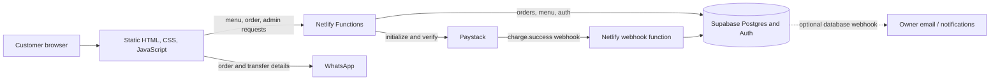

# Dish101

> Nigerian favourites, freshly made and ready to order.

[](https://www.netlify.com/)
[](https://www.typescriptlang.org/)
[](https://paystack.com/)
[](https://supabase.com/)
[](LICENSE)

**Live demo:** [Dish101 on Netlify](https://your-dish101-site.netlify.app) <!-- Replace with the production URL. -->

## Screenshots

Add current screenshots to `docs/screenshots/` before launch. Keep these paths or update them when adding the images.

| Hero | Menu | Cart |
| --- | --- | --- |
|  |  |  |

| Payment | Admin |
| --- | --- |
|  |  |

## Features

- Responsive restaurant storefront with category tabs, menu badges, gallery, and contact links.
- Cart drawer with quantity controls, persistent browser storage, and WhatsApp ordering.
- Online checkout initialized by a Netlify Function and verified with Paystack.
- Bank-transfer fallback that displays the restaurant's transfer details and sends order/receipt details through WhatsApp.
- Supabase-backed menu and order records; the server recalculates prices from the current menu.
- Admin-protected Netlify API routes for menu and order management.

> **Current scope:** this repository includes admin APIs, not a browser-based admin dashboard. Bank-transfer receipt sharing currently uses WhatsApp; an in-app receipt upload flow and owner email provider are not wired up yet.

## Tech stack

| Area | Technology |
| --- | --- |
| Storefront | HTML, CSS, vanilla JavaScript |
| Serverless API | Netlify Functions, TypeScript, Zod |
| Database and authentication | Supabase Postgres and Supabase Auth |
| Payments | Paystack |
| Notifications | WhatsApp links; owner email can be added through a configured provider or Supabase Database Webhook |
| Hosting | Netlify |

## Architecture



## Project structure

```text
.
├── .github/
│   ├── ISSUE_TEMPLATE/
│   │   ├── bug_report.md
│   │   └── feature_request.md
│   └── pull_request_template.md
├── css/
│   └── styles.css
├── docs/
│   └── screenshots/
├── img/                         # Storefront image assets
├── js/
│   ├── config.js                # Public restaurant/contact/bank details; never secrets
│   ├── cart.js
│   ├── main.js
│   └── menu.js
├── netlify/
│   └── functions/
│       ├── _shared/
│       ├── admin-menu.ts
│       ├── admin-orders.ts
│       ├── menu.ts
│       ├── order.ts
│       ├── paystack-webhook.ts
│       └── verify-payment.ts
├── supabase/
│   └── schema.sql
├── .env.example
├── .gitignore
├── CONTRIBUTING.md
├── LICENSE
├── README.md
├── index.html
├── payment-success.html
├── netlify.toml
├── package.json
└── tsconfig.json
```

## Getting started

### Prerequisites

- Node.js 20 or later and npm
- A Supabase project
- A Paystack account (use test keys during development)
- Netlify CLI (installed with the project's development dependencies)

### Install and run locally

```bash
git clone https://github.com/olarinoyeakinloye4-wq/DISH101.git
cd DISH101
npm install
```

Copy `.env.example` to `.env` and set the values for your own Supabase and Paystack projects. Then start the site:

```bash
npm run dev
```

Open [http://localhost:8888](http://localhost:8888). The `dev` script runs `netlify dev --port 8888`, which serves the static site and its functions together. **Live Server only serves static files and cannot run Netlify Functions**, so API-backed menu loading, checkout, and admin operations will not work correctly with Live Server.

### Environment variables

| Name | Description | Where to get it |
| --- | --- | --- |
| `SUPABASE_URL` | Supabase project URL | Supabase Dashboard → Project Settings → API |
| `SUPABASE_SERVICE_KEY` | Server-side service-role key used only by functions | Supabase Dashboard → Project Settings → API; keep private |
| `PAYSTACK_SECRET_KEY` | Paystack server-side test/live secret key | Paystack Dashboard → Settings → API Keys & Webhooks |
| `ADMIN_EMAIL` | Email address allowed to administer the API | The matching administrator's Supabase Auth user |
| `RESTAURANT_WHATSAPP` | Restaurant WhatsApp number in international format, digits only | Restaurant's WhatsApp Business account |

`.env.example` contains placeholder values only. Set real values locally in the ignored `.env` file and in Netlify's environment-variable settings. Restaurant phone, email, WhatsApp, and bank-transfer display details are centralized in [`js/config.js`](js/config.js). Those values are intentionally public in the browser bundle; never put credentials or secrets there.

## Database, storage, and authentication setup

1. Create a Supabase project.
2. Open the Supabase SQL Editor and run [`supabase/schema.sql`](supabase/schema.sql).
3. Create or invite the administrator in Supabase Auth using the exact email configured as `ADMIN_EMAIL`.
4. The schema creates a **private** `receipts` Storage bucket for a future upload flow. The current site shares bank-transfer receipt details through WhatsApp and does not upload files; before enabling uploads, add narrowly scoped server-side upload and verification policies. Never make customer receipts public.

The schema enables row-level security and revokes browser-role table access; Netlify Functions use the server-only service-role key.

## Paystack and webhook setup

1. Add a Paystack test secret key to local `.env` as `PAYSTACK_SECRET_KEY`.
2. The order function creates the checkout transaction and supplies `payment-success.html` as the callback URL.
3. In Paystack Dashboard → Settings → API Keys & Webhooks, set the webhook URL to `https://YOUR-SITE.netlify.app/.netlify/functions/paystack-webhook`.
4. Use Paystack test mode to exercise a successful payment. The webhook validates the SHA-512 signature, verifies the transaction against Paystack, checks the amount against the stored order, and updates the order idempotently.
5. Configure a Supabase Database Webhook or an email provider separately if owner email notifications are required; no email-provider credentials are part of the current application.

## Deploy to Netlify

1. Push the project to a GitHub repository and import it in Netlify.
2. Set the environment variables listed above in **Site configuration → Environment variables**. Do not commit `.env`.
3. Use the repository's `netlify.toml`; it points Netlify at `netlify/functions` and uses esbuild.
4. Deploy the site, then update the Paystack webhook URL to the deployed site's domain.
5. Confirm checkout and webhook delivery with Paystack test mode before switching to live credentials.

## API endpoints

Netlify Functions are available under `/.netlify/functions/`.

| Method | Path | Purpose |
| --- | --- | --- |
| `GET` | `/.netlify/functions/menu` | List available menu items |
| `POST` | `/.netlify/functions/order` | Validate an order, calculate its price server-side, save it, and initialize Paystack |
| `GET` | `/.netlify/functions/verify-payment?reference=...` | Verify a Paystack reference and confirm the matching order |
| `POST` | `/.netlify/functions/paystack-webhook` | Validate Paystack signature and process successful charge events |
| `GET`, `PATCH` | `/.netlify/functions/admin-orders` | List orders or update an order status; admin bearer token required |
| `POST`, `PUT`, `DELETE` | `/.netlify/functions/admin-menu` | Create, update, or delete a menu item; admin bearer token required |

## Security notes

- The browser submits item IDs and quantities, never trusted prices. The order function loads available items and calculates totals from Supabase.
- Paystack webhook signatures are checked with SHA-512 HMAC and timing-safe comparison; successful transactions are verified server-to-server and matched to the stored order amount.
- Keep `SUPABASE_SERVICE_KEY` and `PAYSTACK_SECRET_KEY` in local environment variables or Netlify settings only. Never expose them in HTML, JavaScript, screenshots, or commits.
- Admin endpoints require a Supabase Auth bearer token and the configured administrator email.
- Receipt storage is not currently used. If implemented, keep the bucket private and grant access only through authenticated, narrowly scoped functions.

## Roadmap

- [ ] Add production demo URL and screenshots
- [ ] Build a browser-based admin dashboard over the protected admin APIs
- [ ] Add secure receipt upload and bank-transfer verification
- [ ] Integrate transactional owner email and order status notifications
- [ ] Add automated tests for order validation, payments, and admin access

## Author

Built by **Olarinoye Akinloye Mathew**.

- GitHub: [@olarinoyeakinloye4-wq](https://github.com/olarinoyeakinloye4-wq)
- Portfolio: [Add your portfolio URL](https://your-portfolio.example)

## License

Released under the [MIT License](LICENSE).
